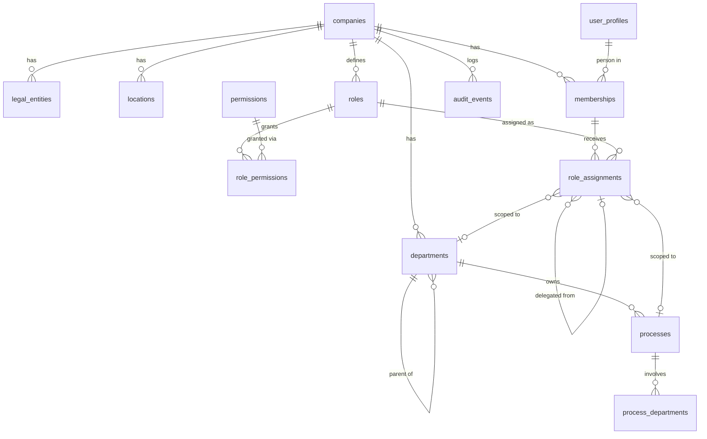
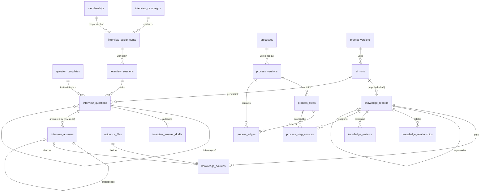
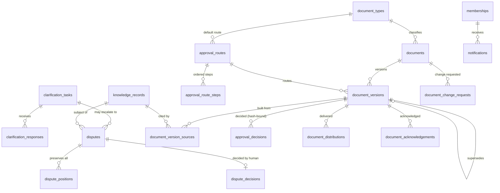

# Entity Relationship Diagram — MVP domains

**Status:** Implemented (migrations PPI-001…012) · Tested locally (131 pgTAP assertions) · Not accepted · 2026-11-11
Column-level detail: `DATABASE_SCHEMA_REFERENCE.md` (generated). Every tenant table carries `company_id`; relationships below are enforced with composite `(company_id, id)` foreign keys, so a row can only reference rows of the same company.

## 1. Organisation, access and audit

## 2. Interview → evidence → knowledge → process

## 3. Collaboration and controlled documents

## 4. Design decisions applied

| Ref | Decision | Where enforced |
|---|---|---|
| C-04 / D-012 | `claim_origin` separate from `lifecycle_status`; plus `state_kind` (as_is / to_be / policy) | `knowledge_records`, `private.knowledge_guard` |
| C-05 | Assignment status (invited…completed) separate from session status (in_progress…closed) | `interview_assignments`, `interview_sessions` |
| C-06 | Review steps come from a configurable, versioned route; process uses `active`, documents use `published` | `approval_routes`, `approval_route_steps` |
| D-011 | Provider may receive data only up to its approved classification; training-allowed providers capped at `public` | `ai_provider_policies`, `private.ai_run_guard` |
| AC-01 | Answers append-only; corrections are linked revisions with a reason | `interview_answers` triggers |
| AC-07/08 | Publish only when every route step is approved for the current content hash; published versions frozen | `private.document_version_guard`, `private.approval_decision_guard` |
